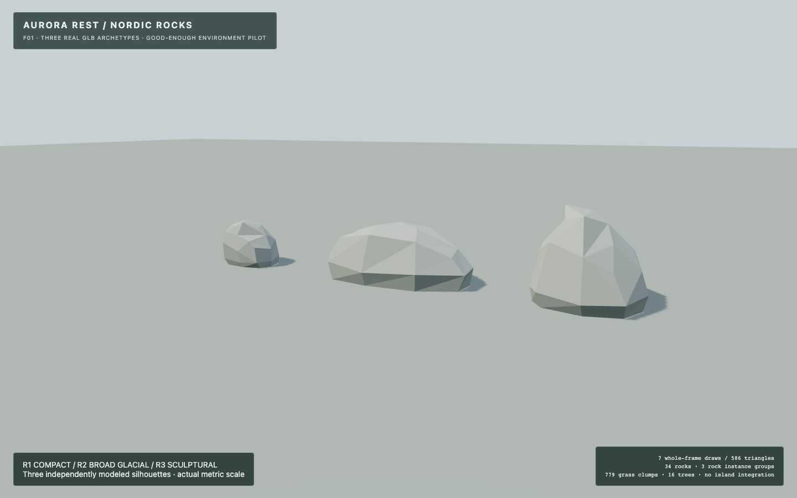
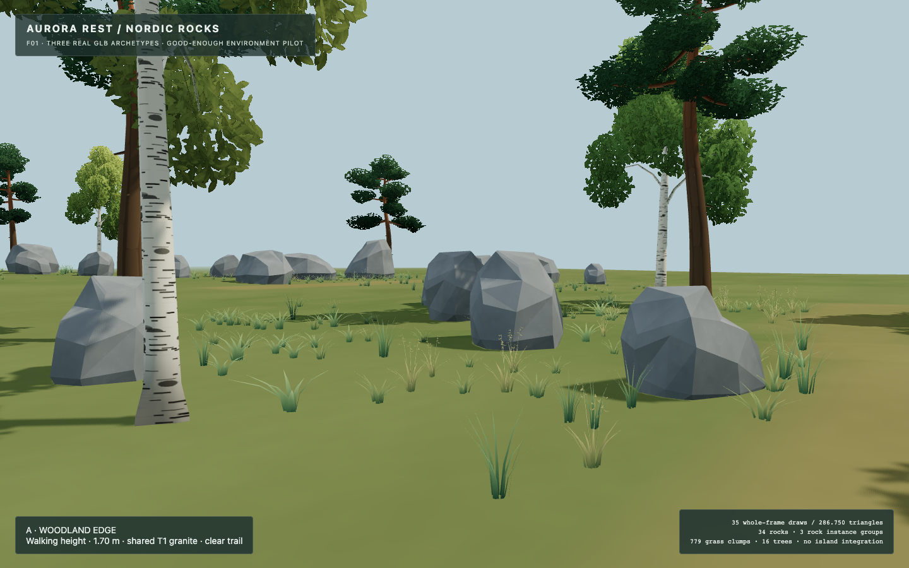
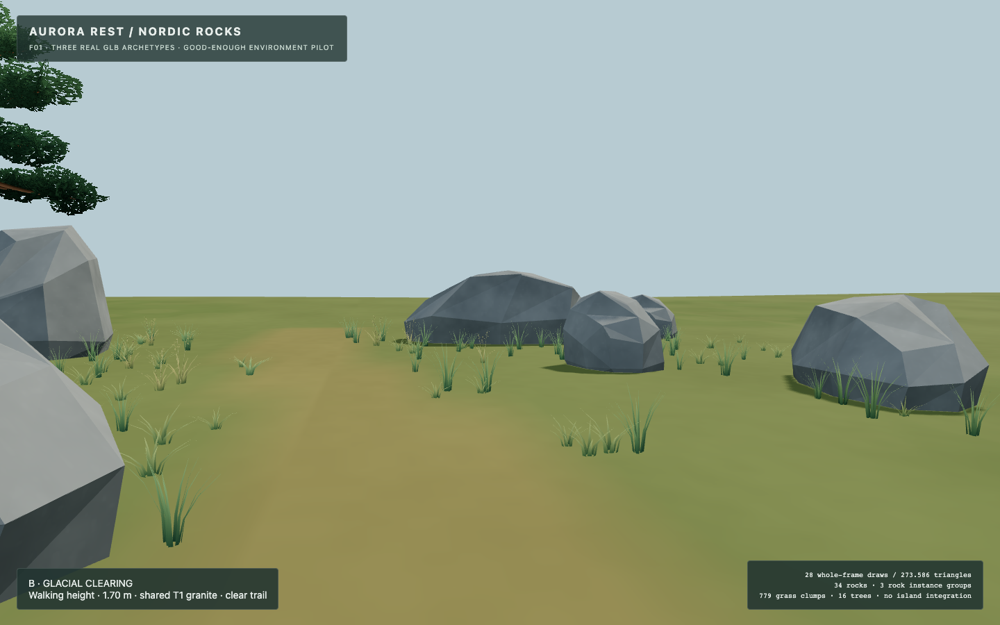
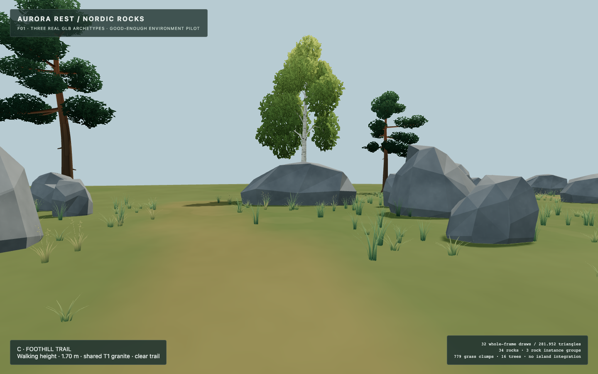

# ASSET-01F01 — Nordic rock family technical checkpoint

**R2 and R3: ART NOT APPROVED.** The owner requested that the current low-poly forms be frozen and the valid implementation preserved. No more sculptural iterations are planned. Technical infrastructure is assessed separately: **VALIDATED STAGING INFRASTRUCTURE**, suitable for reuse in a later authorized task. This report does not approve these new shapes for island production.

R1 is the unchanged S1R compact environment-rock candidate. This milestone makes no new owner art approval for R1. R2 reads broad and low; R3 has a distinct taller, deeper silhouette, but their triangular plane structure and limited sculptural articulation do not establish the desired artistic standard. Their editable sources and runtime exports remain useful technical pilot evidence. G1 remains the protected artistic reference and is not remodeled, replaced or claimed surpassed.

## Repository and environment

- Repository: `Algolon/Aurora-Rest`, verified HTTPS origin.
- Isolated branch: `art/asset-01f01-nordic-rock-family-pilot`.
- Authorized parent: `cb77977c4b8652045f32657f19b14743ecd2ab6e` on S1R; no unrelated branch merge.
- Original checkout and other worktrees were left alone. Only new F01 files and its CI workflow are added.
- Native macOS arm64 Blender **5.2.2 LTS**, build `d13f752e3b9c`; actual executable/background/bpy/Cycles/glTF exporter tested. The original S1R project was opened successfully in preflight.
- Node 24.16.0 locally; CI uses Node 22. TypeScript, Vite and genuine Chromium WebGL2 executed.
- Final GitHub implementation SHA and observed CI results are recorded in the checkpoint addendum after push; no CI success is inferred from local tests.

## Preserved models and construction

R1 references the original S1R files in `art/blender/s1r-sculptural-polish/`; SHA tests guarantee unchanged `.blend` and `.glb` bytes.

New R2/R3 files live in [art/blender/f01-nordic-rocks](art/blender/f01-nordic-rocks/README.md). Each has an independently authored, explicitly connected shared-vertex cage, source patch metadata and named structural vertex groups. No CSG, random primitive generation, copied G1 geometry or enlarged S1R mesh is used. Nonplanar patches are split before export, selected edges receive a single narrow bevel, and flat normals preserve facets. The source and evaluated export are separate editable objects in clearly named collections; studio objects are excluded from GLB.

R2 retained its first candidate. R3 received exactly one correction before the owner's freeze: lowering crown point W from 3.08 to 2.86 m. Initial metrics/renders and initial GLB WebGL screenshots are preserved. No further geometry changes followed the freeze. The builder is reproducible, but its automated plane construction has limited artistic refinement; this is an execution/art-direction limitation, not a Blender limitation.

| Archetype | Dimensions W × H × D (m) | Source vertices / faces after explicit splits | Export welded / attribute vertices | Triangles | GLB / Blender bytes |
|---|---|---|---|---:|---:|
| R1 compact, existing S1R | 2.157 × 1.657 × 1.566 | 39 / see original S1R metrics | 50 / 260 | 96 | 12,456 / 127,537 |
| R2 broadGlacial | 5.130 × 1.940 × 2.560 | 32 / 52 | 47 / 248 | 90 | 11,924 / 101,923 |
| R3 sculptural | 3.500 × 2.857 × 3.320 | 33 / 55 | 55 / 302 | 106 | 14,176 / 102,940 |

All exports have one mesh, one primitive and one material slot; metres, Y-up, ground-plane origin `(0,0,0)`, identity object transforms, finite position/normal/UV/color attributes. R2/R3 use selected-object binary glTF 2.0 export without lights, cameras or animation. Native source/runtime checks and independent exported geometry checks find one connected closed shell, zero boundary/nonmanifold/degenerate/winding defects, Euler characteristic 2 and positive signed volumes. Nonadjacent BVH triangle-overlap screening reports no candidates; this screening is not a formal proof against every possible geometric self-intersection.

[Saved project validation](art/blender/f01-nordic-rocks/saved-project-validation.json) independently reopens each `.blend` and matches its evaluated triangle positions to its real GLB reimport. Each new model has eight genuine neutral Cycles views in its `renders/` folder.

## Reusable technical interface and material

[rockFamily.ts](rocks/f01/rockFamily.ts) exposes stable IDs `compact`, `broadGlacial`, `sculptural`, asset URLs, measured bounds, real GLTFLoader loading, ordinary mesh placement, instance groups, shared resource statistics and idempotent cleanup. Partial/invalid loads release completed geometries. Placement is explicit and deterministic; geometry and the material are shared across instances. Caller-supplied material is borrowed, otherwise the family owns its material factory/maps.

A2 T1 Nordic Granite palette, textures and protected generator/shader source are unchanged. One existing lookdev factory is reused; it allocates nine study maps once, while T1 uses three. F01 wraps its compile hook locally to rotate micro-normal axes with instance transforms. This is an integration adapter, not new material lookdev. Metric triplanar coordinates maintain comparable grain density across the differently sized source models; exported UVs remain available.

Actual ordinary-versus-instanced T1 comparison changed only **3 of 1,296,000 pixels** beyond RGB tolerance 12 (maximum RGB difference 18). Lifecycle probing in the real browser observed disposal of all three geometry resources, the shared T1 material, its three attached textures and one instance buffer; no managed children remained after repeated disposal. The existing factory disposes its additional unused study maps through its existing ownership method.

## Nature demonstration and evidence

[rock-f01.html](rock-f01.html) contains three separated sample areas on a small purpose-built demonstration heightfield: Woodland Edge, Glacial Clearing and Foothill Trail. It uses actual approved Aurora birch, Scots pine, grass/ground-cover and ground texture sources unchanged. It has no playable-world terrain dependency.

Seed 10101 places **34 rocks: 24 compact, 5 broad glacial, 5 sculptural**, with irregular spacing, varied yaw, restrained scale, conservative rock clearance, footprint anchoring and clear trail strips. The demo contains 16 trees and 779 grass clumps. Tree/ground density is illustrative; it is not an island population specification.

[Curated 12-image review](f01-evidence/review.html) shows R2/R3 neutral geometry, metric family comparisons in neutral/T1, all three zones elevated and at human height, a wide view and performance diagnostic. [Raw evidence](f01-evidence/raw/) retains all **24 actual Chromium captures**. Initial screenshots are preserved separately. These images are WebGL evidence, not concept art. Existing working-title overlays do not constitute art approval.

Representative images:

## Technical validation

[Machine-readable local results](f01-evidence/local-validation.json), [browser metrics](f01-evidence/browser-metrics.json), [performance and material parity](f01-evidence/performance.json) and per-model native metrics accompany this report.

- **57/57 Node tests pass**, including actual GLB topology/normals/bounds, R1 binary protection, shared resource ownership, failed-load cleanup, deterministic placement, pairwise clearance and trail clearance. Existing tests are unchanged.
- TypeScript check, original Vite production build and F01 Vite production build pass. Existing large-bundle warning remains; code splitting is deferred.
- Actual Chromium GLB loads, shader compilation and 24 screenshot captures pass with **zero recorded browser console/page/HTTP/WebGL errors**.
- Original-source birch, Scots pine, grass and production rock parity passes against read-only pin `17eafb0902833fb1121c77083f9f862eb4ffcd96`. No external source repository is edited or pushed.
- Four independent original-versus-Aurora grass material comparisons pass with **zero changed pixels and maximum RGB difference 0**.
- Protected asset-lab source, world source, original S1/S1R models, historical experiments and A2/nature implementations have no diff from the approved foundation. No existing tests or policies are weakened.
- New CI checks static exports, tests/builds, protected source parity and genuine WebGL. Blender is verified locally; CI does not install Blender or claim source editability/art approval.

## Performance observations and limits

Unique rock triangles: **292**. Shared rock geometry buffers: **34,152 bytes**, excluding CPU loader objects/instance matrices/material maps. The 34 placed rocks account for **3,284 triangles** before render-pass multiplication. Three instance groups use the same three geometry resources and one T1 material.

In the wide diagnostic view, Three.js reports **301,764 rendered triangles** and **43 drawcalls** including ground, vegetation and shadow participation. Equivalent ordinary rock meshes produce **105 drawcalls**, with the same triangle total and geometry/texture counts (15 / 12). These are whole-frame renderer counters, not individual rock costs: three rock batches represent three color-pass draws and additional shadow-pass work. Coarse batching retains all rocks whenever a batch is visible.

Headless SwiftShader observations: 60-frame instanced median RAF **237.5 ms**, p95 **273.5 ms**, median CPU render submission **0.30 ms**; ordinary meshes median RAF **236 ms**, p95 **275.9 ms**, submission **0.40 ms** over 45 samples. These software-rendering observations establish reproducibility and drawcall reduction, **not hardware desktop FPS or an Android performance claim**. No performance speedup is claimed from these timings. Vegetation/ground dominate this small rock pack's triangle costs.

No LODs, collision proxies, streaming integration or production population tuning are provided. Source cages remain mostly explicitly triangulated to avoid warped-face ambiguity; patch metadata aids editing but does not confer artistic quality. R2/R3 need a separate owner-directed art decision before production use; no additional art work is undertaken here.

## Final disposition and controlled handoff

| Item | Disposition |
|---|---|
| R1 unchanged S1R | Existing candidate preserved; no new approval |
| R2 broad glacial shape | **ART NOT APPROVED** |
| R3 sculptural shape | **ART NOT APPROVED** |
| Blender → GLB reproducible pipeline | **TECHNICALLY VALIDATED** locally |
| Registry, shared material, deterministic placement, instancing and cleanup | **TECHNICALLY VALIDATED** in tests/WebGL |
| Production world integration | **NOT PERFORMED / NOT AUTHORIZED** |

[Integration handoff](rocks/f01/INTEGRATION_HANDOFF.md) documents paths, IDs, scale/pivots, ownership, reuse/instancing, conditional biome recommendations, embedding, collision/LOD work and authoritative-world checkpoint requirements. It proposes no automatic integration and selects no outdated world branch. The technical interface can be reused independently of these unapproved shapes.

The next step is owner review of this frozen checkpoint and a separately scoped decision about accepted geometry and controlled integration. This task stops at the preserved three-rock pack, demo and safe handoff. No merge, deployment, release or island edits.
