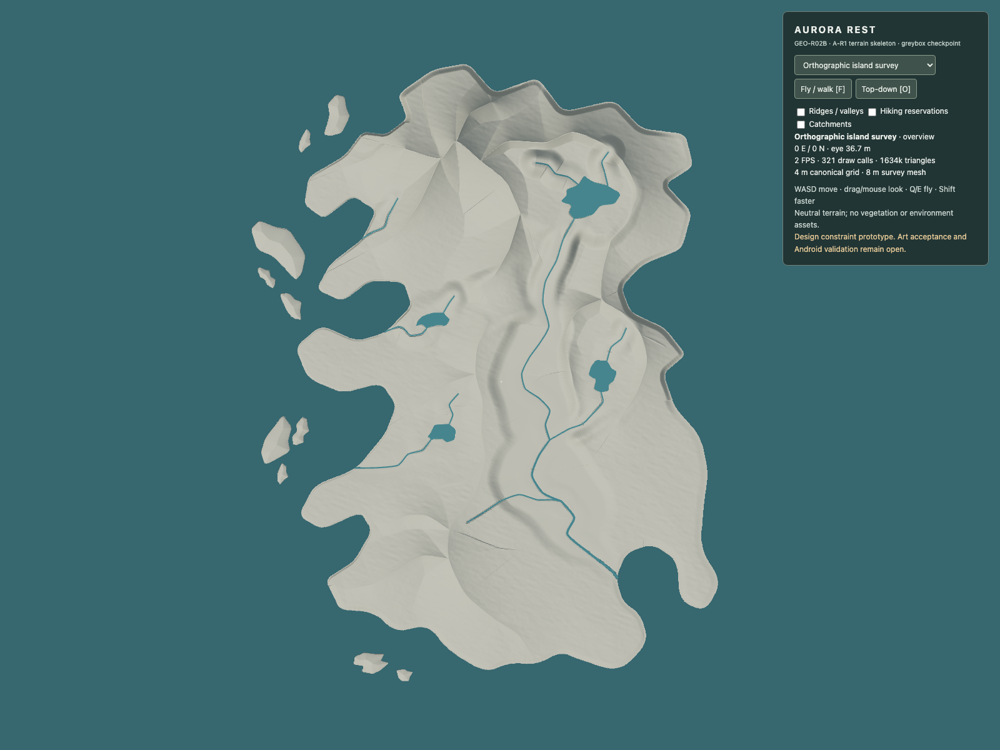
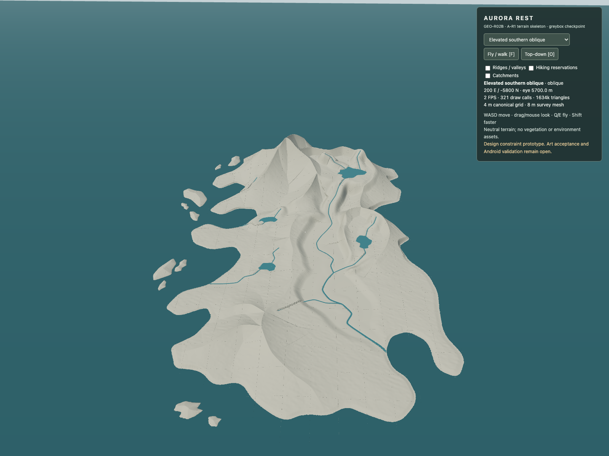
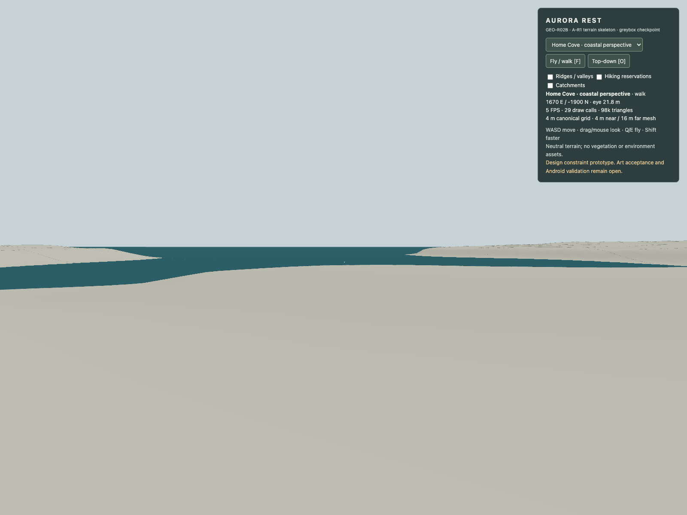
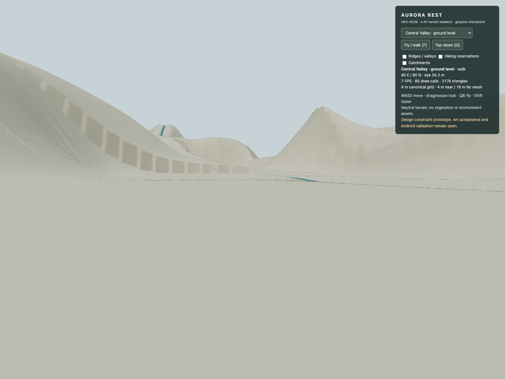
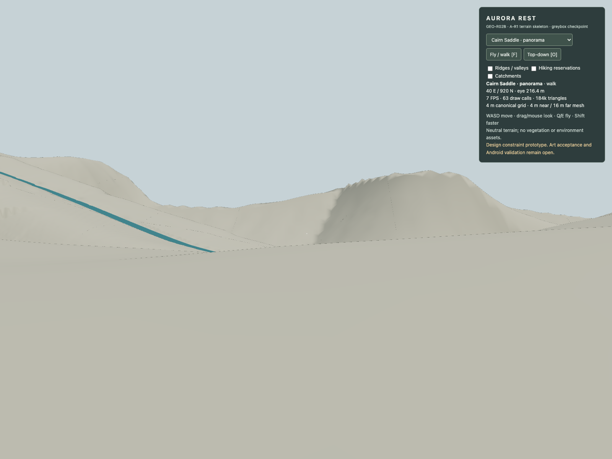
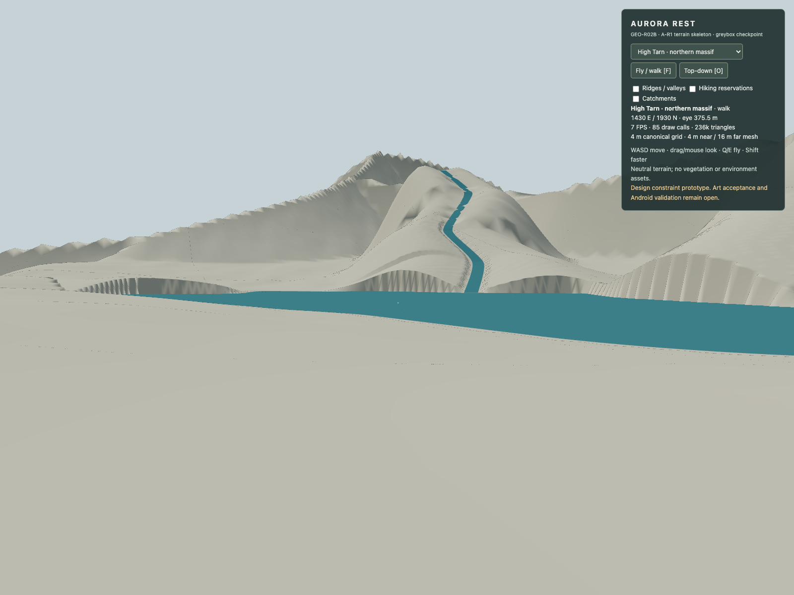
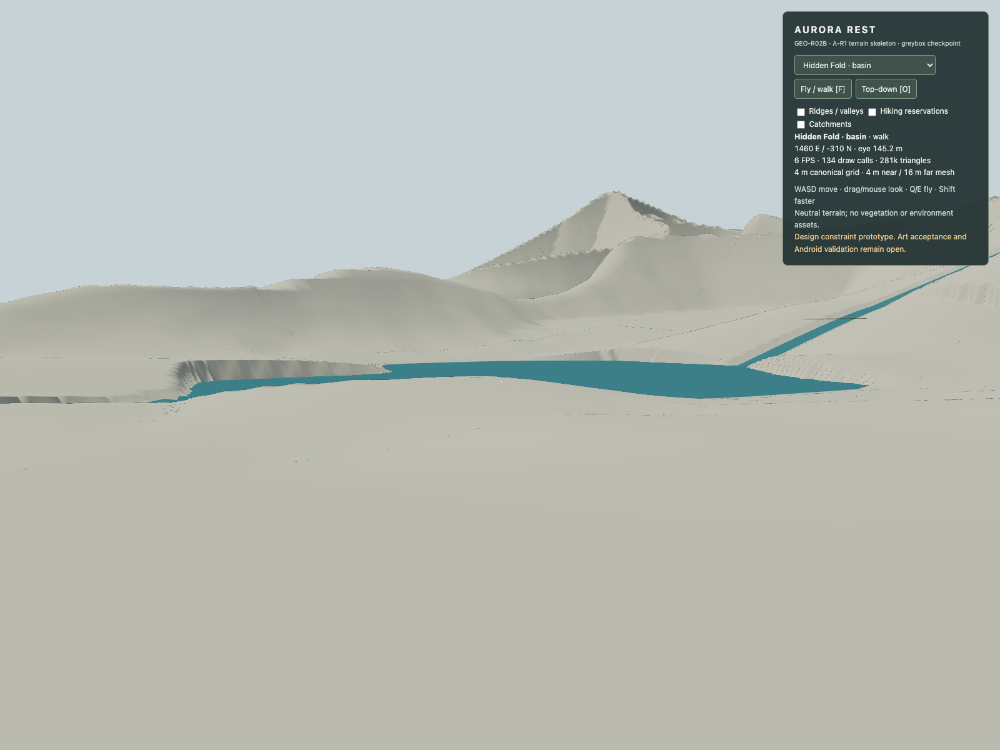
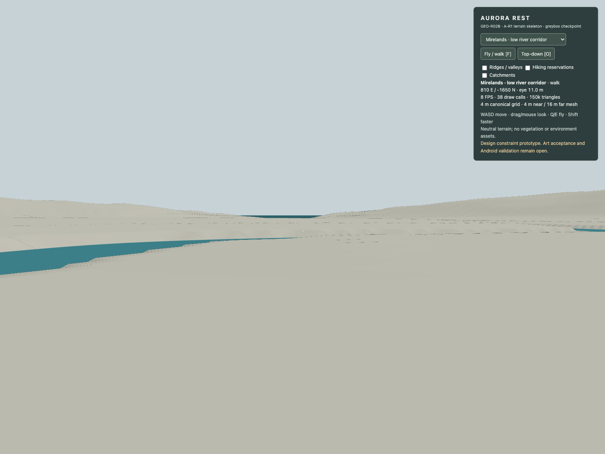

# GEO-R02B — Concept A-R1 terrain skeleton, checkpoint 1

**Recommendation: preserve this review checkpoint; do not accept the terrain for world population.** A-R1's geographic identity is reproduced in a real Three.js scene, but full catchment drainage, the six walking centreline reservations and the naturalness of the 3D landforms do not pass. Artistic approval remains with the user.

The eight images below are unretouched browser-rendered WebGL captures. They are neither concept images nor heightmap visualizations. The neutral material makes structural defects visible. [Open the visual review](review.html) or run the separate [prototype entry](../../geo-r02b.html).

## Source, scope and ancestry

- Approved source: `aurora-rest-concept-a-r1`, schema 2.0.0, revision GEO-R02A-R1.1. Master SHA-256: `62cb154b4ab6473ae7e2507449cea5407774503cdc09fe42f09adbde0a0ec598`.
- The approved master is copied byte-for-byte in [design-master-A-R1-v1.json](design-master-A-R1-v1.json). Its original [plan geometry checks](geometry-check-A-R1.json) are retained separately from the new terrain checks. Original A/B/C and R1 artifacts were not edited.
- Runtime base: `c3621ea7d73334d6cd16b5af096d3f933a249845`. Primary WORLD-01B checkout was clean at this SHA. Remote verified as `https://github.com/Algolon/Aurora-Rest.git`; existing branches/worktrees and AGENTS/project instructions inspected before implementation.
- Observed default `main`: `d543f66a85f120a182eebe56e2d24f5770f250fb`, containing only README. User explicitly approved the narrow AGENTS §2 exception to branch from the runtime checkpoint. Branch: `codex/geo-r02b-a-r1-terrain-skeleton`.
- No merge, deployment, release, asset population or production geography change. The existing `src/world`, `src/render`, main application and WORLD-01B tests remain untouched. The new entry is `geo-r02b.html`; Vite builds both entries.
- Reused architecture principles: tiled BufferGeometry, continuous shared height sampling, skirts, walk/fly/survey controls and browser QA. The prototype does not call WORLD-01B's Gaussian/elliptical terrain or its water generation. No Feh Lu We dependency or assets were introduced.

The source recheck passes its documented geometric tolerance. It finds all **16 ridge branches, 64 shared crest nodes, eight catchments, 13 channels, four lakes, 10 islets, six walking reservations and crossings M1/H1/H2**. Crest references, water graph descent/acyclicity, lake inlets/spills, rings and overlap were checked. Tessellating the analytic coast independently produces a 0.185 m boundary difference against the catchment rings and 452.7 m² symmetric difference. This is explicitly within a 0.5 m curve tessellation tolerance; it is not a claim of mathematically identical polylines. See [source-preflight.json](source-preflight.json).

## Terrain that is implemented

The 6 × 8 km envelope and transformation remain `x = 10u - 3000`, `z = 4000 - 10v`. Canonical rows run southward, with north at positive world z and east at positive world x. The orthographic camera displays north up/east right. The mirrored rendering transform is applied consistently to cameras and the scene; authored coordinates are not changed.

A deterministic 1501 × 2001 float32 elevation field at 4 m spacing combines the approved coastline signed-distance field, all connected ridge branches with asymmetric compact flank profiles, independently authored valley floor polygons/axes/widths, the two basin envelopes, four irregular lake shapes and a saddle constraint. Shape-preserving cubic crest heights interpolate the actual crest knots. Closest-segment projection removes nearest-vertex ridge height steps. Low-amplitude seeded detail refines exposed flanks; it does not define the coast or major landforms. No Gaussian hills or elliptical lake primitives are used.

All 13 channels carve the field before their water ribbons are built from the same path/height samples. Broad valley floors are independent of river width. Hidden Fold's outlet gorge and the two independent western woodland drainage systems remain separate. The dry hiking reservations never flatten terrain.

The canonical finite height range is -141.78 to 899.12 m. The runtime uses 4 m nearby and 16 m distant tiles, 8 m in survey mode, with continuous per-tile triangle contact sampling and skirts. This is a validation prototype, not a final terrain engine or optimization pass. Coarser meshes and skirts still show seams/shore artifacts in some views; validating the canonical field does not certify every distant rendered water edge.

### Explicit prototype departures

1. Streams narrower than 16 m are temporarily resolved at **16 m wetted width**, allowing four canonical cells across. Eleven channel segments are affected. Authored and resolved widths are exported separately. This exaggerates mountain streams and needs conforming sub-grid water/terrain geometry before final approval.
2. Indicative bed depths receive `max(0.25 m, local water grade × 4 m × 0.7)` of raster interpolation allowance. Original and resolved depths are both exported. This preserves water-surface levels but can make small gullies too deep.
3. Lake margins transition to lake level over an authored interpretation of 55–300 m around the exact vector shore. The two basin envelopes support the upland shelf/enclosed basin before outlet carving. These broad profiles still require sculptural review.
4. Offshore island heights (22–78 m) are provisional polygon-distance rock volumes. Their approved footprints/groups are preserved; detailed outcrop geology is not validated.
5. The three flat, 3.5 m wide diagnostic crossing decks are explicit proposals at the named crossing locations. They are not approved bridges. Reservations need approach bends to meet decks; automatic walking along the original drawn centreline does not establish those approaches.

No approved river centreline, water-surface control elevation, coastline ring, lake boundary or master coordinate was silently moved. `junctionCorrections` in the generation record is empty: the final geometry did not require the provisional inlet level reconciliation. Initial inlet/shore errors were resolved through basin support, bank/shore treatment and raster depth allowance. All interpretation parameters live in the new generator, while the original master remains immutable.

## Water and terrain checks

These are geometric measurements of the generated field, **not** erosion, discharge, flood, tidal or fluid simulation. See [terrain-validation.json](terrain-validation.json).

- 0 sampled channel interiors have terrain above their resolved water level. All 13 resolved water-surface profiles are non-increasing downstream.
- 0 failures across the tested lake inner-shore and non-outlet rim probes. High Tarn remains 360 m, Hidden lake 118 m, upper Birchwood lake 86 m, lower lake 48 m. Spill/inlet controls retain their approved relationships.
- 81 eligible bank probes remain below the adjacent water-surface level. Lake areas, other channel junctions and short source/outlet caps are excluded explicitly. These residual bank issues are a technical blocker, not a flooding result.
- Bed samples may have small upward raster ripples even though the water surface descends. The table records their measured maximum; zero centreline exposure is not proof of a hydraulically smooth bed or full wetted-section containment.

| Channel | Length m | Minimum sampled water depth m | Maximum bed rise between samples m |
| --- | --- | --- | --- |
| tarn-inlet-w | 594 | 0.968 | 0.000 |
| tarn-inlet-n | 434 | 1.331 | 0.000 |
| main-upper | 2956 | 0.763 | 0.000 |
| main-mire-upper | 967 | 1.096 | 0.000 |
| main-mire-out | 1260 | 0.052 | 0.042 |
| fold-inlet | 468 | 0.936 | 0.000 |
| fold-outlet | 903 | 0.670 | 0.000 |
| birch-upper-in | 239 | 0.973 | 0.000 |
| birch-upper-outlet | 574 | 0.717 | 0.015 |
| birch-lower-in | 416 | 0.579 | 0.000 |
| birch-lower-outlet | 1026 | 0.154 | 0.024 |
| windward-gully | 683 | 0.676 | 0.000 |
| south-fen-tributary | 1219 | 0.608 | 0.011 |

A separate 20 m steepest-neighbour D8 diagnostic tests which system terrain points reach. Reaching an authored lake/channel then follows its separately checked downstream graph. This is a coarse diagnostic, not the actual watershed boundary or proof of catchment fidelity. Class 06 accepts the windward gully **or direct coast**, consistent with independent minor coastal drainage.

| Catchment | Reaches intended system | Unresolved closed descent |
| --- | --- | --- |
| 01 | 64.4% | 33.5% |
| 02 | 15.4% | 70.1% |
| 03 | 94.4% | 5.6% |
| 04 | 7.2% | 48.8% |
| 05 | 54.8% | 19.1% |
| 06 | 61.4% | 38.5% |
| 07 | 69.3% | 24.0% |
| 08 | 84.9% | 14.7% |

Priority flood identifies **7 unintended closed depressions** deeper than 2 m and at least 800 m², excluding designed water. These were recorded rather than automatically filled, because blind filling could destroy the approved ridges and passes. Full drainage acceptance fails.

| Deepest location x/z m | Affected area m² | Fill depth to escape m |
| --- | --- | --- |
| [800, 1040] | 127200 | 58.625 |
| [340, 1120] | 48400 | 42.004 |
| [-400, 820] | 5600 | 7.525 |
| [160, -1220] | 72000 | 3.985 |
| [1160, -900] | 7200 | 3.806 |
| [580, -1880] | 21600 | 2.963 |
| [1160, -1920] | 8000 | 2.483 |

The largest upper-central pockets require a terrain cross-section study and an explicit local gully/outlet connection into the existing upper-main valley. The dry side of the saddle must remain intact. The western lake catchments need slope/divide refinement rather than being forced into the main river. Mirelands needs a connected low terrace/channel cross-section without raised banks trapping adjacent low ground. These are proposed corrections for user review, not performed master edits.

## Saddle and walking reservations

| Pass location | Measured m |
| --- | --- |
| saddle | 214.66 |
| north-flank | 329.33 |
| south-flank | 236.81 |
| approach-0 | 120.17 |
| approach-1 | 199.06 |

Cairn Saddle is a real local low point between its two tested high flanks. However, its south flank and east/west approaches miss the proposed elevations: south 285 m proposed; west approach 170 m; east approach 155 m. The prototype measures different values above. A pass existing in 3D does not yet mean the complete approach route is feasible.

The following grades are sampled on the actual 4 m raster triangles along the original drawn centrelines, with diagnostic deck contact where they intersect. Very large maxima can reflect an unaligned channel/deck approach or a cut bank; they are **not** recommended hiking gradients. None of the six complete centrelines is accepted. The wet-crossing conflicts partly result from the prototype's widened streams and provisional deck orientation. These failures describe this terrain interpretation; they do not automatically invalidate or authorize edits to the approved A-R1 plan. [hiking-profiles.csv](hiking-profiles.csv) and the JSON contain positions and conflict examples.

| Reservation | Length km | Target grade | P95 grade | Over target samples | Wet samples | P10 dry width through centreline m |
| --- | --- | --- | --- | --- | --- | --- |
| hero | 4.76 | 25.0% | 65.0% | 13.9% | 12 | 75 |
| tarn-ascent | 1.29 | 30.0% | 59.8% | 30.0% | 0 | 0 |
| peak-ascent | 3.44 | 30.0% | 136.1% | 56.6% | 0 | 0 |
| hidden-loop | 3.83 | 28.0% | 59.0% | 13.4% | 16 | 20 |
| west-cape-spur | 1.80 | 30.0% | 35.6% | 7.5% | 0 | 160 |
| south-shoulder-loop | 3.50 | 30.0% | 54.6% | 30.0% | 0 | 0 |

Width is a sampled contiguous dry cross-section through the proposed centreline with at most 35% transverse slope, not the sum of disconnected dry patches. The separate widest contiguous span is also recorded in JSON. It is not a final construction width or a guarantee of an entire 3D route. The inspection controller blocks terrain steps above 70% grade; that permissive limit is not the 25–30% hiking target. Local browser walking/contact was checked only at Central Valley; no claim of end-to-end traversal is made.

| Crossing | Deck level m | Water m | Length m | Bank steps m |
| --- | --- | --- | --- | --- |
| M1 | 13.00 | 10.23 | 61.4 | 0.16/0.15 |
| H1 | 51.78 | 49.00 | 54.0 | 0.17/0.15 |
| H2 | 154.17 | 149.59 | 54.0 | 0.15/0.23 |

Proposed localized corrections, without flattening mountains:

- **Hero/M1:** bend the reserved route onto the perpendicular crossing and back to the dry terrace. Then inspect the steep western climb into the Central Valley and the upper approach to Cairn Saddle. Use the 130 m reservation first; request a small corridor amendment only if a measured candidate cannot fit.
- **Hidden loop/H1/H2:** provide switchback approaches into the 3.5 m deck alignments; the original centreline crosses outside parts of the decks. Preserve the basin enclosure and outlet gorge. Any gorge side ledge needs a section, not an arbitrary tunnel.
- **Tarn/peak:** test longer contour-following ascents and genuine rock saddles. The 110/150 m envelopes may be insufficient for the desired grades; an expanded reservation or a declared steep optional summit route is preferable to lowering the massif.
- **West cape/South Shoulder:** move short steep portions laterally onto a shoulder/contour bench where the measured reservation allows. Retain their coastal side-route identity.

## Actual 3D review against A-R1 and the illustration

The outline, western bays/capes, four island groups, southeastern Home Cove, northern massif/tarn, western woodland lakes, eastern enclosed basin, broad central lowland, southwestern shoulder and eastern sandy coastal setting retain their approved geographic relationships. The orthographic survey is the strongest result; it does not establish scenic quality.

Compared with the original illustration, the prototype lacks the intended interlocking rock buttresses, asymmetric subsidiary gullies, varied glacial valley sides and readable landscape reveals. Some northern forms still look like extruded crest profiles or pyramidal faces. The Central Valley is broad but parts of its flanks read as uniform walls. High Tarn has a supported elevated basin but overly engineered gullies/shore transitions. Its inlet visibly follows a raised spine in places rather than a convincing valley; centreline bed clearance does not resolve that landform failure. Hidden Fold's enclosure is legible; the transitions need sculpting. South Shoulder is connected as a lower branch system but too smooth. The sandy east coast and Home Cove remain too flat to convey their intended coastal composition. Mirelands has low relief and a connected authored channel, while its surrounding drainage is not fully correct.

These are terrain-form issues visible with neutral material. Adding plants or rock assets would not resolve them. No production vegetation, weather, style lighting or population pass was started. Art fidelity is **not accepted**.

### Orthographic island survey



### Elevated southern oblique



### Home Cove · coastal perspective



### Central Valley · ground level



### Cairn Saddle · panorama



### High Tarn · northern massif



### Hidden Fold · basin



### Mirelands · low river corridor



## Verification, reproducibility and stop

- `npm test`: **21/21 pass**. Nineteen tests concern the unchanged WORLD-01B implementation. The two new tests raycast real Three.js geometry against contact interpolation at 4/8/16 m, including edges/diagonals and coordinate bounds. They do not assert that A-R1 hiking or drainage passes.
- `npm run build`: passes TypeScript and the Vite production build for both entries. Vite reports the shared Three.js chunk above 500 kB; no optimization gate is claimed.
- Source preflight passes the documented 0.5 m tessellation tolerance. All generated heights are finite.
- Browser camera checks: real WASD fly movement, drag look, survey/ground switching, all three overlays and local ground contact. Eight actual captures are tied to the source/terrain hashes in [runtime.json](evidence/runtime.json).
- Renderer is **SwiftShader software WebGL** in headless Chromium. Triangle/draw counts and the short settled-frame samples are diagnostic only, not desktop GPU or physical Android performance validation. Neither 60 FPS desktop nor 30 FPS Android is certified.
- Terrain SHA-256: `0e2788a52066463881d346dda4c7018b2155208c82916c5552e1824215fec462`. An independent repeat generation reproduced the identical terrain and exported features against the implementation commit; see [verification-results.json](verification-results.json). Generation time is informational and is excluded from terrain identity.

Reproduce from this branch using Node 24 or newer and Python 3.11+:

```sh
npm ci
python3 -m venv /tmp/aurora-geo-r02b-venv
/tmp/aurora-geo-r02b-venv/bin/pip install -r tools/geo-r02b/requirements.txt
/tmp/aurora-geo-r02b-venv/bin/python tools/geo-r02b/preflight.py
/tmp/aurora-geo-r02b-venv/bin/python tools/geo-r02b/generate.py
/tmp/aurora-geo-r02b-venv/bin/python tools/geo-r02b/validate.py
npm test
npm run build
npm run dev -- --port 4197 --strictPort
# In another terminal, with an installed Playwright Chromium or CHROME path:
npm run geo:capture
/tmp/aurora-geo-r02b-venv/bin/python tools/geo-r02b/report.py
```

The supplied binary/features also allow `npm ci` plus `npm run dev -- --port 4197 --strictPort` without installing Python. Open `/geo-r02b.html`. `CHROME` overrides the browser executable; otherwise Playwright's installed browser is used, with a detected existing macOS headless Chromium 1234 fallback. `WORLD_URL` overrides the local URL. The generator can use `AURORA_PY_TOOLS` for an isolated Python library directory; the temporary local path is only a convenience, not a runtime dependency.

**Acceptance decision:** retain A-R1 as the geographic design baseline and keep this branch as a reproducible failed/pending terrain validation candidate. Do not start population or call the terrain art-approved. Next approval should cover a narrowly scoped terrain correction checkpoint addressing drainage pockets/banks, realistic flank transitions and measured route approaches. This milestone stops here: no merge or deployment.
